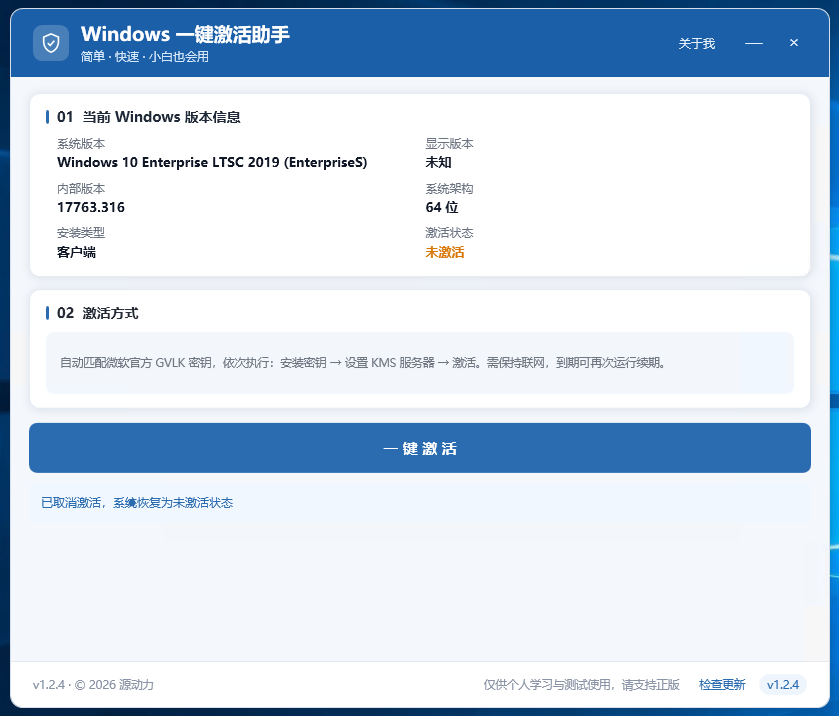
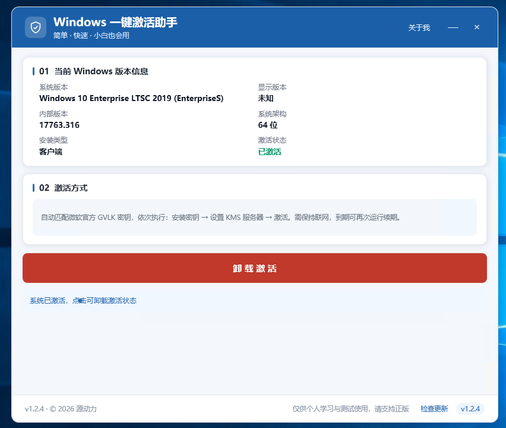
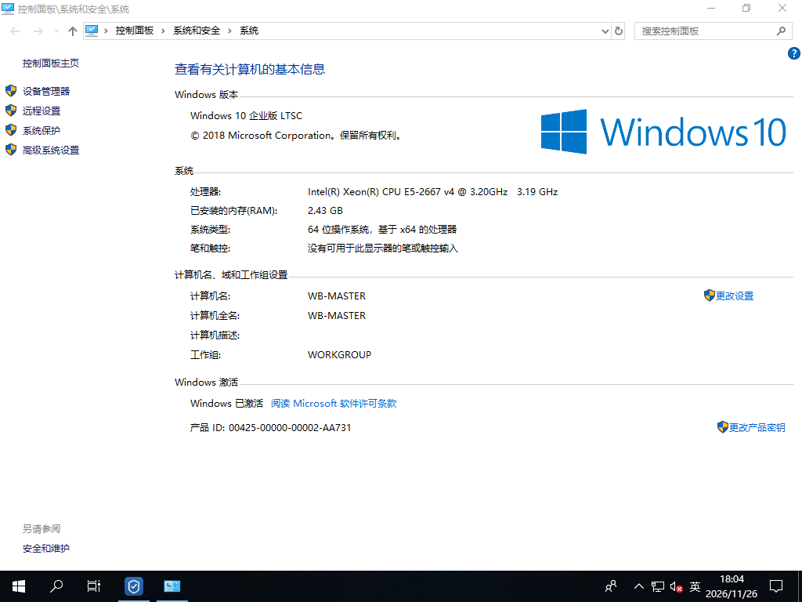

<div align="center">

# Windows 一键激活助手

**把装密钥、设 KMS 服务器、发起激活三条命令，压成一个按钮的桌面工具。**

单文件 exe · 免安装 · 全程静默 · GPL-3.0 开源

</div>

---

## ✨ 特性

- **一键激活**：自动读取系统 `EditionID`，匹配微软官方公开的 GVLK 密钥，依次执行 `slmgr /ipk` → `slmgr /skms` → `slmgr /ato`，全程静默无黑窗
- **状态实时确认**：轮询 WMI `SoftwareLicensingProduct`，确认 `LicenseStatus` 变为已授权才报成功，命令退出不等于激活完成
- **卸载激活**：已激活时按钮自动变红色「卸载激活」，一键执行 `slmgr /upk` 恢复未激活
- **零弹窗**：成功失败都写在状态栏，唯一的系统交互是 UAC 提权
- **自动更新**：启动时检查 Gitee Release，支持一键下载替换升级，页脚可手动检查
- **系统信息展示**：自动读取系统版本、内部版本、架构、安装类型与当前激活状态

## 📥 下载

从 [Releases](https://gitee.com/lixiaoliyubo/windows-activation-helper/releases) 页下载 `WindowsActivationHelper.exe`（约 220 KB）。

## 🚀 使用方法

1. 双击运行，UAC 弹窗点「是」（工具需要管理员权限执行 slmgr）
2. 界面显示当前系统信息与激活状态
3. 点蓝色「**一键激活**」，等状态栏变绿即可
4. 需要取消时，点红色「**卸载激活**」

## 🖼 运行截图

<div align="center">
&nbsp;&nbsp;
<br>
<sub>左：启动即读取系统信息与激活状态　·　右：点「一键激活」后确认授权才报完成</sub>
</div>

<div align="center">

<br>
<sub>激活后系统属性显示「Windows 已激活」</sub>
</div>

## 📋 环境要求

| 项 | 要求 |
|---|---|
| 系统 | Windows 10 / 11（家庭版不在 KMS 批量授权范围，工具会明确提示） |
| 权限 | 管理员（slmgr 本身要求） |
| 网络 | 需能连通预配置的 KMS 服务器 |
| 运行时 | 无需安装，系统自带 .NET Framework 4.8 |

## 🔧 编译

```bat
build.cmd
```

环境：Windows + .NET SDK（项目以 SDK 10.0.400 编译，目标框架 `net48`），产物输出到 `publish\WindowsActivationHelper.exe`。

## 📦 一键发布

`release.bat` 把「编译 → 抄产物 → 推送仓库 → 上传测试机」四步串成一条命令：

```bat
release.bat            :: 用脚本内 DEFAULT_VERSION
release.bat 1.2.5      :: 指定版本号
```

脚本按顺序执行：

1. `dotnet build -c Release -p:Version=<版本号>`，产物拷进 `publish\`
2. `git add -A` / 提交 / 推送 `gitee main`（有 `github` remote 时顺带推送，失败只警告）
3. `Copy-VMFile` 把 exe 传到测试虚拟机的 `C:\va\latest`

任一步失败立刻中止并打印原因；虚拟机名、目标目录、默认版本都在脚本头部集中配置，改一行即可复用。

## 📁 目录结构

```text
src/MasActivator/                WPF 源码
  MainWindow.xaml               单页界面
  MainWindow.xaml.cs            系统信息读取、GVLK 匹配、slmgr 调用
  UpdateService.cs              版本检测与自更新
  App.manifest                  DPI 感知与管理员权限清单
screenshot/                     运行截图（未激活 / 已激活 / 系统属性）
publish/WindowsActivationHelper.exe  成品
build.cmd                       一键编译脚本
release.bat                     一键发布脚本（编译 + 推送 + 上传测试机）
```

## 📄 免责声明

本工具仅供个人学习与测试使用。激活依赖第三方 KMS 服务器，服务器可用性不受本工具控制。请遵守所在地区的法律法规，商业环境请购买正版授权。使用产生的风险由使用者自行承担。

## 📃 许可证

[GPL-3.0](LICENSE)
