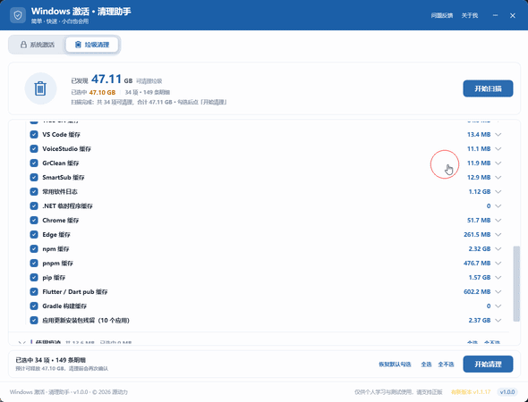
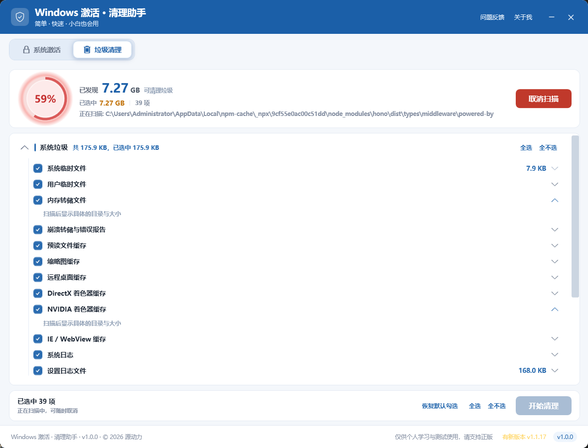
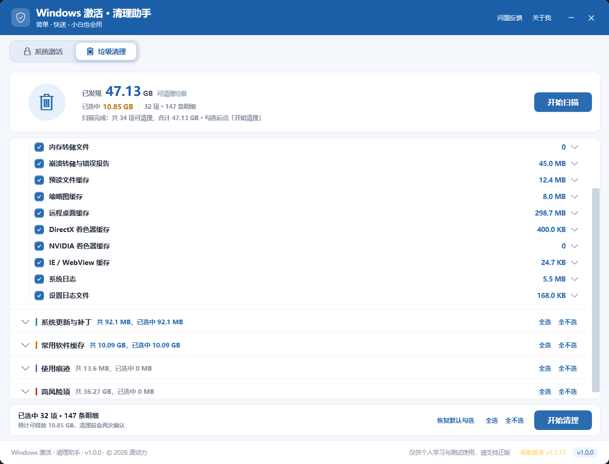
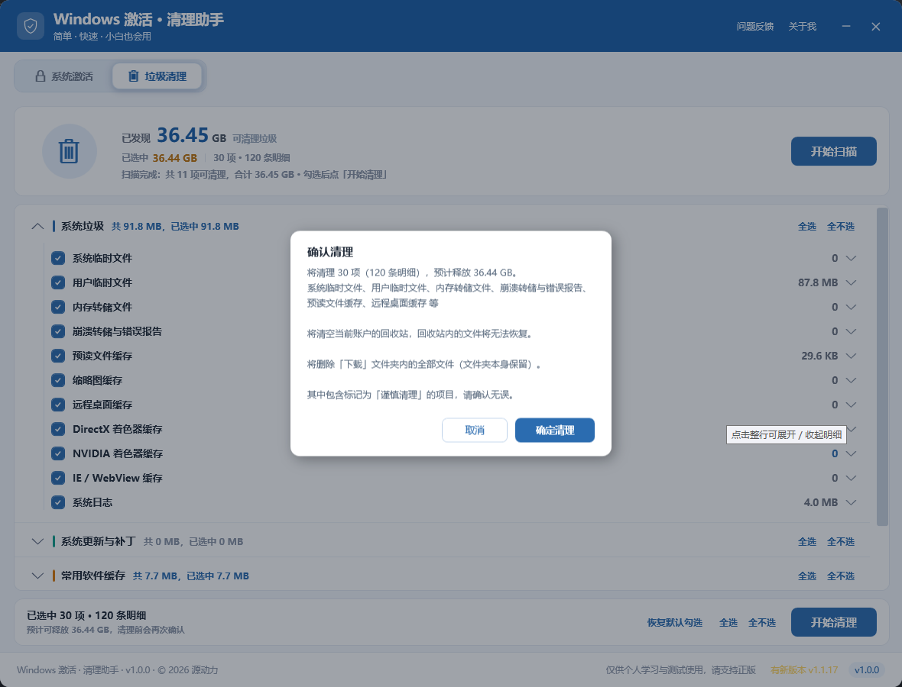

# Windows 激活 · 清理助手

**一个按钮完成激活，一个按钮清扫垃圾：把装密钥、设 KMS、发起激活三条命令，加上散落全盘的临时文件与缓存，收进同一个桌面工具。**

单文件 exe · 免安装 · 全程静默 · GPL-3.0 开源

---

## ✨ 特性

### 系统激活

- **一键激活**：自动读取系统 `EditionID`，匹配微软官方公开的 GVLK 密钥，依次执行 `slmgr /ipk` → `slmgr /skms` → `slmgr /ato`，全程静默无黑窗
- **状态实时确认**：轮询 WMI `SoftwareLicensingProduct`，确认 `LicenseStatus` 变为已授权才报成功，命令退出不等于激活完成
- **卸载激活**：已激活时按钮自动变红色「卸载激活」，一键执行 `slmgr /upk` 恢复未激活
- **零弹窗**：成功失败都写在状态栏，唯一的系统交互是 UAC 提权
- **系统信息展示**：自动读取系统版本、内部版本、架构、安装类型与当前激活状态

### 垃圾清理

- **41 项清理清单**：系统垃圾 / 系统更新与补丁 / 常用软件缓存 / 使用痕迹 / 高风险项 五组；覆盖微信、QQ、飞书、抖音、豆包、Chromium 系浏览器、npm / pnpm / pip / pub / Gradle 等缓存，补丁与 IIS 日志，注册表 MRU 痕迹（删除前自动导出 `.reg` 备份）
- **并发扫描 + 并发清理**：扫描 4 路、清理 3 路，顶部环形进度实时显示百分比与「正在扫描 / 清理: 当前路径」，随时可取消
- **树形清单**：分组 → 项 → 明细三层，竖向引导线；点整行即展开/收起，不必瞄准小箭头
- **明细可逐条勾选**：每个目录 / 文件 / 注册表键单独显示体量与勾选框，可只清其中一部分，底栏同步「已选中 N 项 · M 条明细」
- **右键定位**：在任何子级路径上右键，可直接在资源管理器打开文件夹、定位到文件，或复制路径
- **删除可靠性**：文件删除走 Win32（支持超过 260 字符的长路径）、只读属性自动去除后重试、遇到 junction / 符号链接直接跳过不跟随、被占用或无权限的文件计入失败数并在结果里提示，不会虚报释放空间
- **更新缓存可清干净**：清理「系统更新与补丁」前自动暂停 `wuauserv` / `dosvc`，清理结束（含取消）自动恢复
- **高风险项默认勾选 + 二次确认**：回收站、下载文件夹属默认勾选并带「谨慎清理」红标；确认弹层会明确写出「将清空当前账户的回收站」「将删除「下载」文件夹内的全部文件」
- **问题反馈入口**：标题栏「问题反馈」可填写内容，自动附带版本与系统信息，一键复制并打开官网反馈页
- **自动更新**：启动时检查 Gitee Release，支持一键下载替换升级，页脚可手动检查

## 📥 下载

从 [Releases](https://gitee.com/lixiaoliyubo/windows-activation-helper/releases) 页下载 `WindowsActivationHelper.exe`（约 290 KB）。

## 🚀 使用方法

1. 双击运行，UAC 弹窗点「是」（工具需要管理员权限执行 slmgr 与清理系统目录）
2. 界面显示当前系统信息与激活状态
3. 点蓝色「**一键激活**」，等状态栏变绿即可；需要取消时点红色「**卸载激活**」
4. 切到「垃圾清理」标签页：点「开始扫描」→ 顶部实时显示「已发现 X 可清理垃圾」→ 按需调整勾选（分组全选 / 全不选 / 恢复默认勾选，或展开明细逐条勾选）→ 点「开始清理」→ 应用内确认后执行

> 默认勾选包含回收站与「下载」文件夹，确认弹层会单独点名；不需要清理这两处时，先取消它们的勾选再执行。清理只删除内容、保留文件夹本身，注册表痕迹会先备份到「文档\清理备份」。

## 🖼 运行截图

**功能演示** —— 扫描、展开明细、勾选到清理的完整流程。



**扫描中** —— 环形进度显示百分比，底部实时显示当前正在扫描的目录。



**扫描完成** —— 分组显示总体量与已选中量，项行右侧是每一项的实际占用。



**清理前确认** —— 明确列出项数、明细数与预计释放空间，回收站与下载文件夹单独提示。



**待激活** —— 启动即读取系统版本、内部版本、架构、安装类型与当前激活状态。


**激活完成** —— 点「一键激活」后轮询确认授权状态，成功才报完成，状态栏转绿。


**系统属性** —— 激活后显示「Windows 已激活」。


## 📋 环境要求

| 项 | 要求 |
|---|---|
| 系统 | Windows 10 / 11，32 / 64 位均可（家庭版不在 KMS 批量授权范围，工具会明确提示） |
| 权限 | 管理员（slmgr 与系统目录清理都要求） |
| 网络 | 激活需能连通预配置的 KMS 服务器；更新检查需访问 Gitee |
| 运行时 | 无需安装，系统自带 .NET Framework 4.8 |

## 🔧 编译

```bat
build.cmd
```

环境：Windows + .NET SDK（项目以 SDK 10.0.400 编译，目标框架 `net48`），产物输出到 `publish\WindowsActivationHelper.exe`。

## 📦 一键发布

`release.bat` 把「编译 → 抄产物 → 推送仓库」三步串成一条命令：

```bat
release.bat            :: 用脚本内 DEFAULT_VERSION
release.bat 1.2.5      :: 指定版本号
```

脚本按顺序执行：

1. `dotnet build -c Release -p:Version=<版本号>`，产物拷进 `publish\`
2. `git add -A` / 提交 / 推送 `gitee main`（其余 remote 顺带推送，失败只警告）

任一步失败立刻中止并打印原因；默认版本号在脚本头部集中配置，改一行即可复用。

## 📁 目录结构

```text
src/MasActivator/                WPF 源码
  MainWindow.xaml               界面（系统激活 + 垃圾清理 + 确认/反馈弹层）
  MainWindow.xaml.cs            系统信息读取、GVLK 匹配、slmgr 调用、确认与反馈
  CleanupTab.cs                 清理页：树形清单渲染、并发扫描/清理、环形进度、右键定位
  DiskCleaner.cs                清理清单、并发扫描、Win32 删除（长路径/只读/链接）、注册表备份、回收站 API
  UpdateService.cs              版本检测与自更新
  App.manifest                  DPI 感知与管理员权限清单
screenshot/                     README 用截图（激活、清理演示、扫描、清单、确认）
截图/                            开发过程截图（各轮 UI 迭代留档）
publish/WindowsActivationHelper.exe  成品
build.cmd                       一键编译脚本
release.bat                     一键发布脚本（编译 + 推送 + 上传测试机）
```

## 📄 免责声明

本工具仅供个人学习与测试使用。激活依赖第三方 KMS 服务器，服务器可用性不受本工具控制。清理功能只删除可再生成的缓存、日志与更新残留，删除前请在确认弹层核对范围。请遵守所在地区的法律法规，商业环境请购买正版授权。使用产生的风险由使用者自行承担。

## 📃 许可证

[GPL-3.0](LICENSE)
